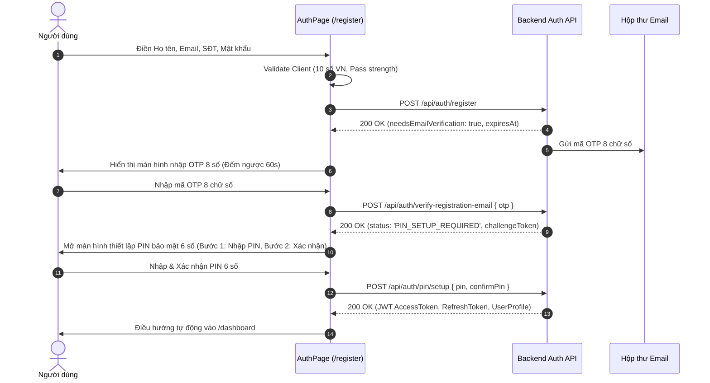
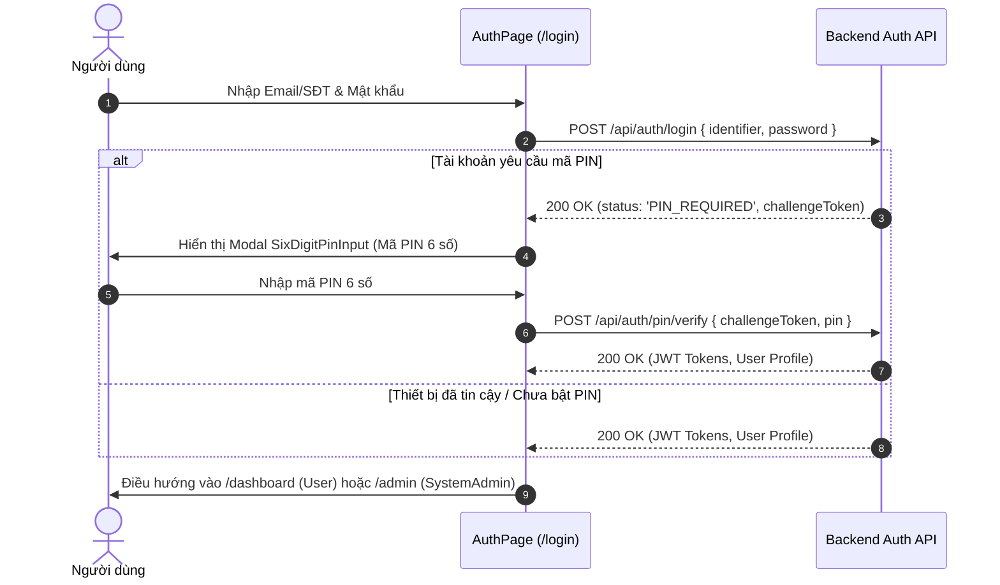

# FUNCTIONAL FLOWS — SPENDWISE END-TO-END WORKFLOWS
**Tài liệu Kiểm kê Các Luồng Tương tác Nghiệp vụ Cốt lõi**  
**Dự án:** SpendWise Web Application  
**Ngày kiểm kê:** 12/10/2026  
**Nguồn xác thực:** Router, AuthProvider, FinancialProvider, SecurityPinChallengeProvider, Chrome Runtime

---

## 1. FLOW 1: ĐĂNG KÝ TÀI KHOẢN MỚI (REGISTRATION -> EMAIL OTP -> PIN SETUP)

- **Entry Point:** `/register`
- **Các bước:**
  1. Nhập thông tin biểu mẫu (Name, Email, Phone, Password).
  2. Xác thực mã OTP 8 chữ số qua email (`POST /api/auth/verify-registration-email`).
  3. Thiết lập mã PIN bảo mật 6 chữ số (`POST /api/auth/pin/setup`).
- **Validation:** SĐT 10 số VN (`0xxxxxxxxx`), Email chuẩn, Mật khẩu tối thiểu 8 ký tự, PIN 6 số không trùng lặp đơn giản.
- **Side Effects:** Cấp phát Access Token, lưu Refresh Token vào `sessionStorage`, chuyển hướng vào `/dashboard`.

---

## 2. FLOW 2: ĐĂNG NHẬP 2 LỚP (LOGIN -> PIN 6-DIGIT CHALLENGE)

---

## 3. FLOW 3: CHUYỂN TIỀN TRỰC TIẾP (DIRECT MONEY TRANSFER)
- **Entry Point:** `/transfer` hoặc click nút "Chuyển tiền" trên Dashboard/Friends.
- **Các bước:**
  1. Chọn Ví nguồn thanh toán (Mặc định hoặc chọn ví khác).
  2. Nhập số điện thoại người nhận (10 chữ số) hoặc chọn nhanh từ Bạn bè đã gắn sao.
  3. Hệ thống gọi `GET /api/transfers/recipients?phone={phone}` hiển thị tên người nhận thời gian thực.
  4. Nhập số tiền (định dạng mask tiền tệ VND tự động) và lời nhắn.
  5. Bấm Tiếp tục -> Bật `SecurityPinChallengeModal` yêu cầu nhập mã PIN bảo mật 6 số.
  6. Gửi lệnh `POST /api/transfers` kèm PIN xác thực.
  7. Hiển thị biên lai chuyển tiền thành công (`BankDirectPaymentDto`), cập nhật số dư ví tức thời.

---

## 4. FLOW 4: NẠP TIỀN VÍ THỬ NGHIỆM (WALLET TESTMODE TOP-UP)
- **Entry Point:** `/wallet` -> Nút "Nạp tiền".
- **Các bước:**
  1. Kiểm tra tài khoản ngân hàng TestMode đang liên kết (`refreshBankConnections`).
  2. Chọn số tiền nạp (Tối thiểu 10.000 ₫) và Ví đích nhận tiền.
  3. Gửi yêu cầu khởi tạo lệnh nạp `POST /api/banking/top-up`.
  4. Hệ thống trả về mã thử thách (Challenge Code).
  5. Xác nhận nạp tiền thử nghiệm `POST /api/banking/top-up/{id}/confirm`.
  6. Số dư ví nội bộ tăng lên tức thì.

---

## 5. FLOW 5: THIẾT LẬP NGÂN SÁCH THÁNG (CATEGORY BUDGETING)
- **Entry Point:** `/budget` -> Nút "Thiết lập ngân sách".
- **Các bước:**
  1. Chọn tháng áp dụng (`MM/YYYY`).
  2. Chọn danh mục chi tiêu chưa có ngân sách (ví dụ: Ăn uống, Mua sắm).
  3. Nhập số tiền hạn mức (Limit Amount).
  4. Tùy chọn Bật/Tắt: Chuyển tiếp ngân sách (Rollover) và Cảnh báo ngưỡng 80%.
  5. Gửi API `POST /api/financial/budgets`.
  6. Thẻ ngân sách xuất hiện với thanh tiến độ phân màu theo giao dịch thực tế trong tháng.

---

## 6. FLOW 6: ĐÓNG GÓP & RÚT TIỀN MỤC TIÊU (SAVINGS GOALS)
- **Entry Point:** `/goals` -> Nút "Nạp tiền" hoặc "Rút tiền" trên thẻ mục tiêu.
- **Các bước:**
  1. Chọn Ví trích tiền / Ví nhận tiền.
  2. Nhập số tiền giao dịch.
  3. Xác thực mã PIN bảo mật 6 số.
  4. Hệ thống thực hiện ghi nợ/ghi có song phương giữa Ví nội bộ và Quỹ mục tiêu.
  5. Cập nhật tỷ lệ % hoàn thành mục tiêu.

---

## 7. FLOW 7: KHỞI TẠO VÀ XỬ LÝ KHIẾU NẠI GIAO DỊCH (DISPUTE LIFECYCLE)
- **Entry Point:** `/disputes` hoặc `/support` -> Nút "Tạo khiếu nại".
- **Các bước:**
  1. User chọn giao dịch bất thường trong danh sách gần đây.
  2. Nhập lý do tranh chấp, số tiền đòi bồi hoàn, đính kèm chứng từ sao kê.
  3. Gửi API `POST /api/cases/disputes`.
  4. Phiếu tranh chấp xuất hiện trên bảng điều hành Admin `/admin/disputes`.
  5. Admin thẩm tra chứng cứ, trao đổi qua khung chat hỗ trợ.
  6. Admin bấm "Chấp thuận & Hoàn tiền" -> Hệ thống tự động kích hoạt bút toán đảo tiền hoàn về ví User.
